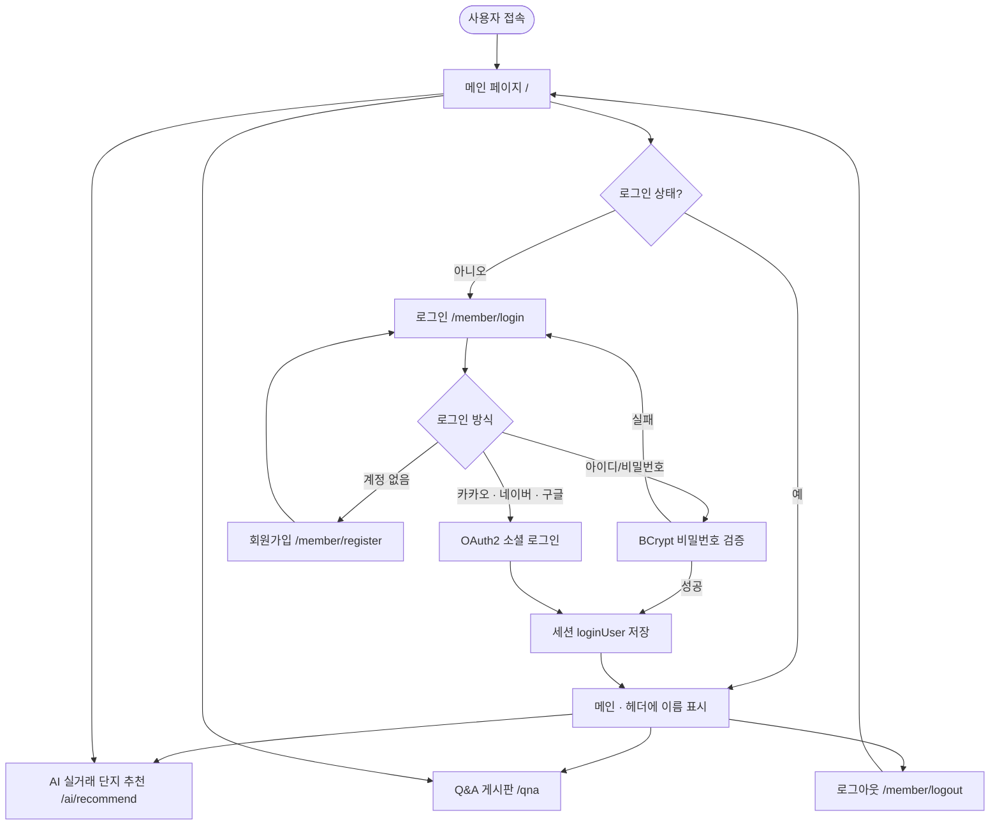
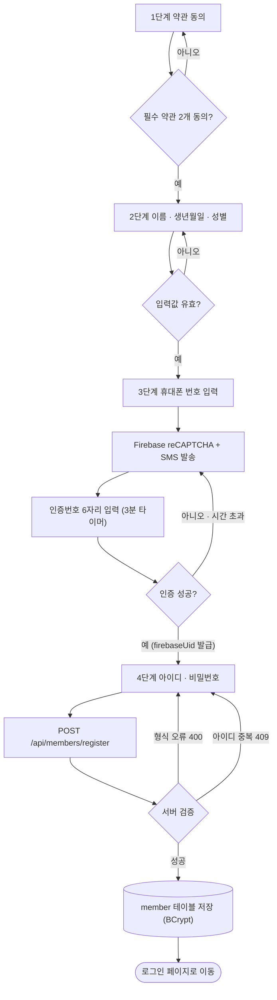
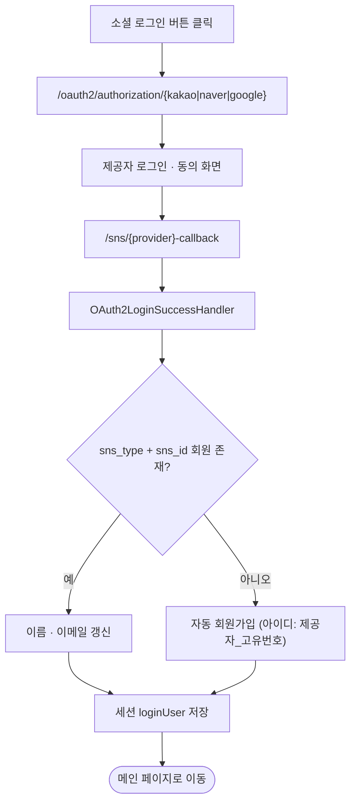
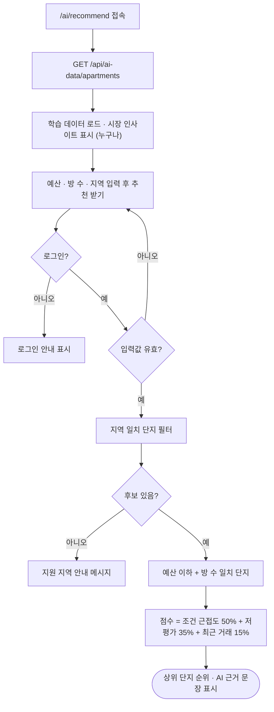
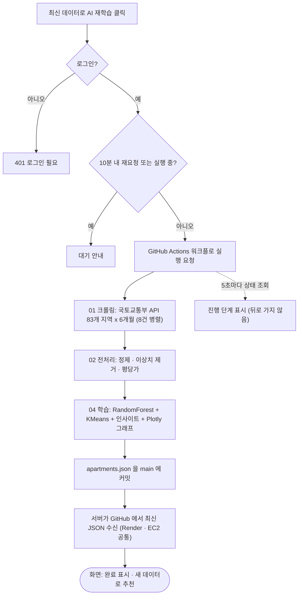

# 1. 플로 차트

[← 산출물 목차](README.md) · 다음: [2. 프로젝트 기획서 →](02-project-plan.md)

사용자가 사이트에서 이동하는 흐름과 주요 기능의 처리 흐름을 그림으로 정리했습니다.

---

## 1-1. 전체 서비스 흐름

## 1-2. 회원가입 흐름 (4단계)

## 1-3. 소셜 로그인 흐름

## 1-4. AI 실거래 단지 추천 흐름

## 1-5. AI 재학습 흐름 (로그인 사용자)

