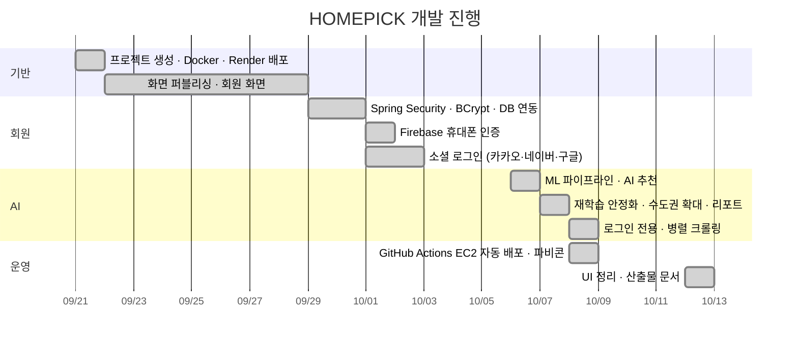

# 2. 프로젝트 기획서

[← 1. 플로 차트](01-flowchart.md) · [산출물 목차](README.md) · 다음: [3. 요구사항 정의서 →](03-requirements.md)

---

## 2-1. 프로젝트 개요

| 항목 | 내용 |
|---|---|
| 프로젝트명 | **HOMEPICK (홈픽)** — 공간을 공간답게, 스마트 부동산 플랫폼 |
| 한 줄 소개 | 국토교통부 **아파트 실거래 데이터를 AI가 학습**해, 내 예산과 조건에 맞는 단지를 거래 기록으로 찾아 주는 웹 서비스 |
| 대상 지역 | 수도권 (서울 25개 구 · 인천 11개 · 경기 47개 = **83개 시·군·구**) |
| 데이터 범위 | 최근 6개월 실거래 (예: 2026-04 ~ 2026-09, 약 **12.9만 건 · 1.8만 단지**) |
| 운영 주소 | Render <https://homepick.onrender.com> · AWS EC2 <https://homepickkr.duckdns.org> |
| 저장소 | <https://github.com/fsclass-n/homepick_lo> |

## 2-2. 추진 배경 및 문제 정의

| 문제 | 설명 |
|---|---|
| 매물 호가와 실제 가격의 차이 | 플랫폼에 올라온 호가는 실제 거래 가격과 다른 경우가 많아, 내 예산으로 실제 어떤 단지를 살 수 있었는지 알기 어려움 |
| 데이터가 흩어져 있음 | 공공 실거래 데이터는 공개되어 있지만 지역 · 월별로 나뉘어 있어 일반 사용자가 비교 · 분석하기 어려움 |
| 저평가 판단 기준 부재 | 같은 지역 · 면적이라도 가격 차이가 큰데, "적정 가격"을 판단할 기준이 없음 |

## 2-3. 목표

1. **실거래 기반 추천**: 예산 · 방 수 · 지역을 입력하면 실제로 거래된 단지를 점수 순으로 추천
2. **AI 적정가 · 저평가 분석**: RandomForest로 적정 거래가를 예측하고, 실제 거래가가 낮은 단지를 저평가로 표시
3. **시장 인사이트 시각화**: 월별 거래량 · 중위가, 가격 결정 요인, 시·군·구 평당가 순위, 단지 유형(KMeans)
4. **최신 데이터 유지**: 버튼 한 번으로 크롤링 → 학습 → 반영까지 자동 수행 (약 2~3분)
5. **간편한 회원 서비스**: 휴대폰 본인인증 회원가입 + 카카오 · 네이버 · 구글 소셜 로그인

## 2-4. 주요 기능

| 구분 | 기능 | 비고 |
|---|---|---|
| 회원 | 4단계 회원가입 (약관 → 기본정보 → 휴대폰 인증 → 계정) | Firebase Phone Auth, BCrypt |
| 회원 | 아이디 로그인 · 로그아웃, 아이디 저장 | 세션 기반 |
| 회원 | 소셜 로그인 + 자동 회원가입 | Spring Security OAuth2 Client |
| AI | AI 실거래 단지 추천 | 로그인 사용자 |
| AI | AI 실거래 분석 리포트 (시장 인사이트) | 누구나 열람 |
| AI | 최신 데이터로 AI 재학습 | 로그인 사용자, GitHub Actions |
| 게시판 | Q&A 게시판 목록 | TiDB `qna` 테이블 |
| 공통 | 반응형 헤더 · 푸터, 맨 위로 버튼, 파비콘 | Bootstrap 5 |

## 2-5. 기술 스택

| 영역 | 기술 |
|---|---|
| Backend | Java 21, Spring Boot 4.1, Spring MVC, Spring JDBC (JdbcTemplate), Spring Security (BCrypt · OAuth2), Lombok |
| Frontend | Thymeleaf, Bootstrap 5.3, Vanilla JS, Font Awesome, plotly.js 4.1 |
| Database | TiDB Cloud (MySQL 호환) |
| 인증 | Firebase Phone Auth (SMS), OAuth2 (Kakao · Naver · Google) |
| AI · 데이터 | Python 3.11, requests, pandas, scikit-learn (RandomForest · KMeans), Plotly |
| 공공데이터 | 국토교통부 아파트 매매 실거래가 API (data.go.kr) |
| CI/CD | GitHub Actions (빌드 · 테스트 · EC2 배포, AI 재학습) |
| 배포 | Render (Docker), AWS EC2 + nginx + Let's Encrypt SSL + DuckDNS |

## 2-6. 개발 일정 (커밋 이력 기준)

## 2-7. 기대 효과

- 사용자는 **호가가 아닌 실제 거래 기록**으로 예산에 맞는 단지를 빠르게 비교할 수 있음
- AI 적정가 대비 **저평가 거래**를 확인해 의사결정 근거로 활용
- 운영자는 서버 재배포 없이 버튼 한 번으로 **최신 데이터 반영**

## 2-8. 제약 사항

- 실거래 데이터는 **이미 거래가 끝난 기록**이며, 현재 시장에 나와 있는 매물과 다를 수 있음 (화면에 명시)
- 실거래가 자료에 방 수가 없어 **전용면적으로 방 수를 추정** (40㎡ 이하 1방 · 60㎡ 이하 2방 · 85㎡ 이하 3방 · 초과 4방+)
- 최근 2개월은 실거래 신고 기한(30일) 때문에 거래량이 적게 집계될 수 있음
