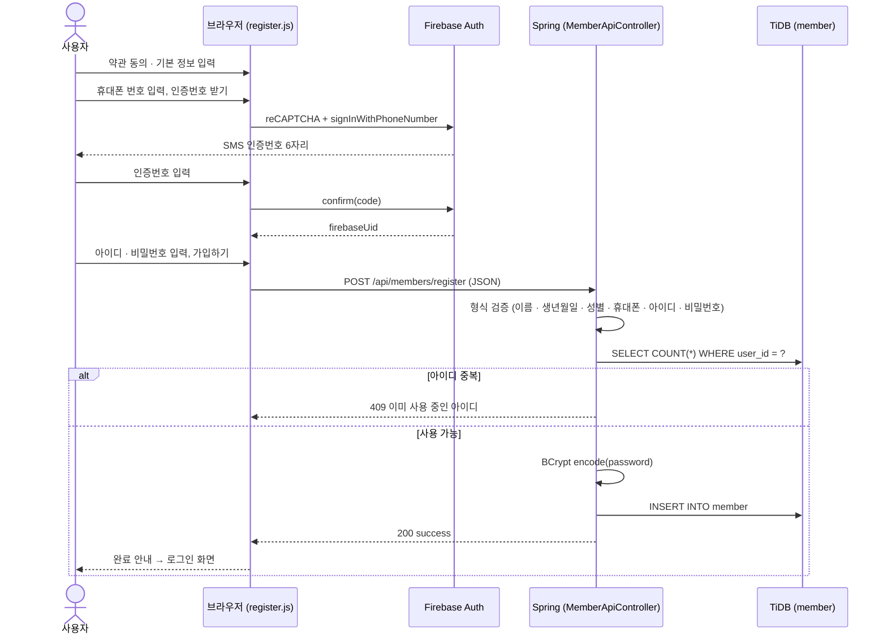
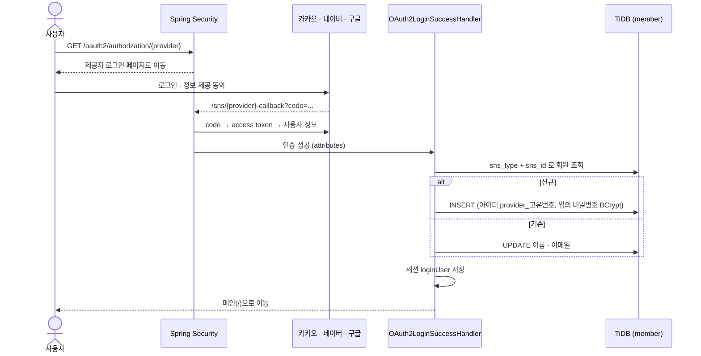
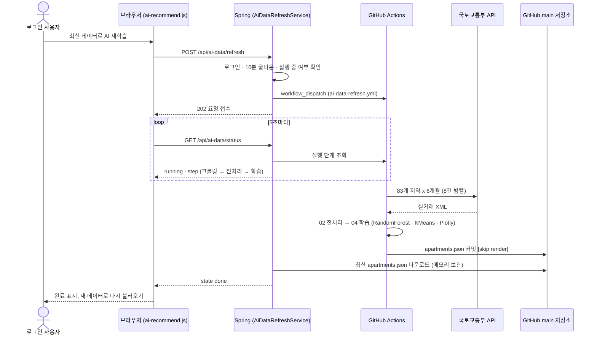
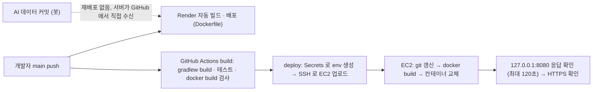

# 4. 프로세스 정의서

[← 3. 요구사항 정의서](03-requirements.md) · [산출물 목차](README.md) · 다음: [5. 시스템 아키텍처 설계서 →](05-architecture.md)

업무 프로세스별로 **누가(액터) · 무엇을 입력해서 · 어떤 처리를 거쳐 · 무엇이 나오는지**를 정의하고, 주요 프로세스는 시퀀스 다이어그램으로 표시했습니다.

---

## 4-1. 프로세스 목록

| ID | 프로세스 | 액터 | 시작 | 결과 | 관련 요구사항 |
|---|---|---|---|---|---|
| P-01 | 회원가입 | 비회원 | 회원가입 버튼 | `member` 저장 | MEM-01~05 |
| P-02 | 아이디 로그인 | 회원 | 로그인 버튼 | 세션 생성 | MEM-06 |
| P-03 | 소셜 로그인 | 비회원 · 회원 | 소셜 버튼 | 자동가입 + 세션 생성 | MEM-08 |
| P-04 | 로그아웃 | 회원 | 로그아웃 링크 | 세션 삭제 | MEM-09 |
| P-05 | AI 단지 추천 | 회원 | AI 단지 추천 받기 | 추천 순위 표시 | AI-01~04 |
| P-06 | 시장 인사이트 조회 | 누구나 | 페이지 접속 | 리포트 표시 | AI-05 |
| P-07 | AI 재학습 | 회원 · GitHub Actions | 재학습 버튼 | 새 `apartments.json` 반영 | AI-07~09, DATA-01~06 |
| P-08 | Q&A 목록 조회 | 누구나 | 고객센터 메뉴 | 게시글 목록 | BRD-01 |
| P-09 | 자동 배포 | 개발자 · GitHub Actions | main 에 push | Render · EC2 새 버전 | NFR-07 |

---

## 4-2. 프로세스 상세

### P-01 회원가입

| 구분 | 내용 |
|---|---|
| 입력 | 약관 동의, 이름 · 생년월일 · 성별, 휴대폰 번호 · 인증번호, 아이디 · 비밀번호 |
| 처리 | ① 단계별 화면 검증 (`register.js`) ② Firebase SMS 인증 → `firebaseUid` ③ `POST /api/members/register` ④ 서버 재검증 · 아이디 중복 확인 ⑤ BCrypt 암호화 후 저장 |
| 출력 | 성공: "회원가입이 완료되었습니다." → 로그인 화면 / 실패: 400(형식) · 409(중복) · 500(DB) 메시지 |
| 예외 | 인증번호 3분 초과 → 재발송, 같은 휴대폰으로 여러 아이디 가입 허용 (아이디 중복만 검사) |

### P-02 아이디 로그인 / P-04 로그아웃

| 구분 | 내용 |
|---|---|
| 입력 | 아이디, 비밀번호 |
| 처리 | `POST /member/login` → `findByUserId` → `passwordEncoder.matches` → 세션 `loginUser`(아이디 · 이름) 저장 |
| 출력 | 성공: 메인으로 이동, 헤더에 이름 표시 / 실패: "아이디 또는 비밀번호가 일치하지 않습니다." (입력한 아이디 유지) |
| 로그아웃 | `GET /member/logout` → `session.invalidate()` → 메인 |

### P-03 소셜 로그인

### P-05 AI 단지 추천

| 구분 | 내용 |
|---|---|
| 입력 | 최대 예산(만원), 희망 방 수, 희망 지역 (예: "마포구", "분당구") |
| 처리 | ① 로그인 확인 ② 입력 검증 ③ 지역명 포함 단지 필터 ④ 예산 이하 · 방 수 일치 ⑤ 점수 계산 · 정렬 (브라우저에서 처리) |
| 점수 | 조건 근접도(예산 · 면적) **50%** + 저평가 점수(valueScore) **35%** + 최근 거래 **15%** |
| 출력 | 상위 단지 순위: 단지명 · 지역 · 실거래 중위가 · 전용면적 · 추정 방 수 · 최근 거래일 · 점수 · AI 근거 문장 |
| 예외 | 비로그인 → 로그인 안내 / 지역 없음 → "수도권만 지원" 안내 / 조건 일치 없음 → 지역 최저 실거래가와 함께 조건 조정 안내 |

### P-06 시장 인사이트 조회

| 구분 | 내용 |
|---|---|
| 입력 | 페이지 접속, 분석 범위 탭 (수도권 전체 · 서울 · 인천 · 경기) |
| 처리 | `GET /api/ai-data/apartments` → 미리 계산된 `insights` · Plotly 그래프 JSON 을 plotly.js 로 표시 |
| 출력 | 01 시장 요약 · 02 월별 거래량 · 중위가 · 03 가격 결정 요인 · 04 시·군·구 평당가 순위 · 05 단지 유형 · 06 저평가 TOP 5 |

### P-07 AI 재학습

| 상태(state) | 화면 표시 |
|---|---|
| `running` | 진행 단계 · 경과 시간 · 진행 막대 |
| `syncing` | 학습 완료, 서버 반영 중 |
| `done` | 완료, 새 데이터 기준 시각 표시 |
| `failed` | 실패 단계 + 원인 (예: "공공데이터 API 응답 시간 초과") |

### P-08 Q&A 목록 조회

| 구분 | 내용 |
|---|---|
| 처리 | `GET /qna` → `QnaService.getQnaList()` → `SELECT ... FROM qna ORDER BY id DESC` |
| 출력 | 번호 · 제목 · 작성자 · 상태(대기중) · 작성일 표 |

### P-09 자동 배포

