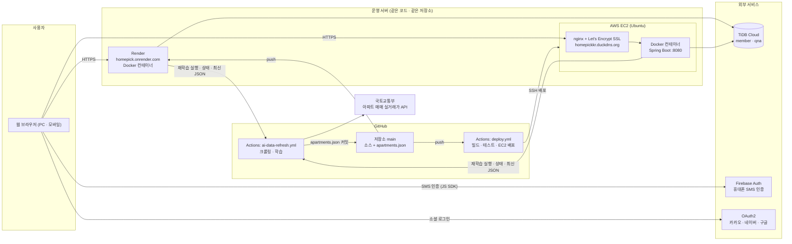
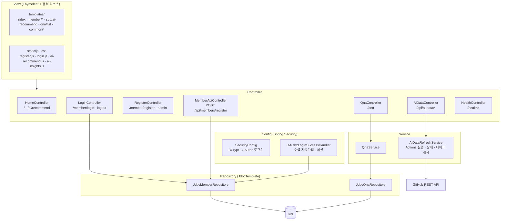
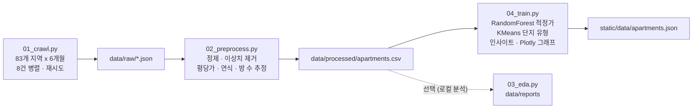
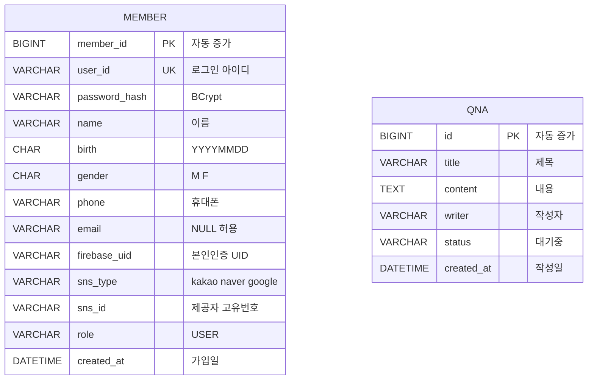

# 5. 시스템 아키텍처 설계서

[← 4. 프로세스 정의서](04-process.md) · [산출물 목차](README.md) · 다음: [6. 화면 설계서 →](06-screen-design.md)

---

## 5-1. 전체 구성도



**핵심 포인트**
- Render와 EC2는 **같은 GitHub 저장소의 같은 코드**를 각각 배포합니다.
- AI 학습은 서버가 아니라 **GitHub Actions에서 한 번만** 실행되고, 결과 `apartments.json` 하나를 두 서버가 함께 씁니다.
- 학습 데이터만 바뀔 때는 재배포 없이, 서버가 GitHub에서 최신 JSON을 직접 받아 메모리에 보관합니다 (30분 캐시, 재학습 완료 시 즉시 갱신).

## 5-2. 애플리케이션 계층 구조 (Spring Boot)



## 5-3. AI 데이터 파이프라인



| 단계 | 파일 | 내용 |
|---|---|---|
| 공통 설정 | `ml-pipeline/common.py` | 경로, 수도권 83개 법정동 코드, 방 수 추정 규칙 |
| 수집 | `01_crawl.py` | `apis.data.go.kr` 호출, 실패 비율이 높으면 중단 · 원인 출력 |
| 전처리 | `02_preprocess.py` | 금액 · 면적 숫자화, 이상치 제거, 파생 변수 |
| 학습 | `04_train.py` | 특성: 면적 · 층 · 연식 + 지역(One-Hot). RandomForest(200 trees) → valueScore, KMeans(최대 8개) → 단지 유형 |
| 결과 | `apartments.json` | `items`(단지), `insights`(시장 분석), `charts`(Plotly), `model`(R² · MAE) |
| 실행 | `.github/workflows/ai-data-refresh.yml` | 크롤링 20분 · 전체 30분 제한, 결과 커밋 `[skip render]` |

`data/` 폴더는 실행할 때 생기는 작업 폴더라 Git 에 올리지 않습니다 (`.gitignore`). 배포 이미지에도 `ml-pipeline/` 은 넣지 않습니다 (`.dockerignore`).

## 5-4. 데이터베이스 설계 (TiDB)



| 테이블 | 인덱스 · 제약 |
|---|---|
| `member` | `user_id` UNIQUE, (`sns_type`, `sns_id`) UNIQUE, `phone` · `firebase_uid` INDEX |
| `qna` | `id` PK |

스키마 원본: [`src/main/resources/schema.sql`](../../src/main/resources/schema.sql)

## 5-5. API 명세

| Method | URL | 설명 | 인증 | 응답 |
|---|---|---|---|---|
| GET | `/` | 메인 페이지 | - | HTML |
| GET | `/member/login` | 로그인 화면 | - | HTML |
| POST | `/member/login` | 아이디 로그인 | - | 메인 리다이렉트 / 오류 메시지 |
| GET | `/member/logout` | 로그아웃 | 세션 | 메인 리다이렉트 |
| GET | `/member/register` | 회원가입 화면 | - | HTML |
| POST | `/api/members/register` | 회원가입 (JSON) | Firebase 인증 | 200 · 400 · 409 · 500 |
| GET | `/oauth2/authorization/{provider}` | 소셜 로그인 시작 | - | 제공자로 이동 |
| GET | `/sns/{provider}-callback` | 소셜 로그인 콜백 | - | 메인 리다이렉트 |
| GET | `/ai/recommend` | AI 실거래 단지 추천 화면 | - | HTML |
| GET | `/api/ai-data/apartments` | 학습 데이터 (gzip) | - | JSON |
| GET | `/api/ai-data/status` | 재학습 진행 상태 | - | JSON (`state`, `step`, `message`) |
| POST | `/api/ai-data/refresh` | AI 재학습 실행 | **로그인** | 202 · 401 · 409 · 502 · 503 |
| GET | `/qna` | Q&A 목록 | - | HTML |
| GET | `/healthz` | 헬스 체크 | - | `OK` |

## 5-6. 배포 · 환경 구성

| 항목 | Render | AWS EC2 |
|---|---|---|
| 주소 | `homepick.onrender.com` | `homepickkr.duckdns.org` |
| 배포 방식 | main push → Render 가 Dockerfile 로 빌드 | main push → Actions 빌드 · 테스트 → SSH 로 EC2 에서 docker build |
| HTTPS | Render 제공 | nginx + Let's Encrypt, DuckDNS 도메인 |
| 환경변수 | Render 대시보드 | GitHub Secrets → 배포 시 `~/homepick.env` 생성 |
| 컨테이너 포트 | `$PORT` | `127.0.0.1:8080` (nginx 통해서만 접근) |

**환경변수**

| 구분 | 이름 |
|---|---|
| DB | `DB_HOST` `DB_PORT` `DB_DATABASE` `DB_USERNAME` `DB_PASSWORD` |
| 소셜 로그인 | `GOOGLE_CLIENT_ID/SECRET` `NAVER_CLIENT_ID/SECRET` `KAKAO_CLIENT_ID/SECRET` |
| Firebase | `FIREBASE_WEB_API_KEY` `_AUTH_DOMAIN` `_PROJECT_ID` `_STORAGE_BUCKET` `_MESSAGING_SENDER_ID` `_APP_ID` |
| AI 재학습 | `GITHUB_ACTIONS_TOKEN` (Secrets 이름은 `GH_ACTIONS_TOKEN`), `GITHUB_REPO` |
| 크롤링 | `DATA_GO_KR_API_KEY`, `CRAWL_MONTHS` (GitHub Secrets) |

## 5-7. 폴더 구조

```
homepick_lo/
├── .github/workflows/      deploy.yml (CI/CD · EC2) · ai-data-refresh.yml (AI 재학습)
├── ml-pipeline/            Python 크롤링 · 전처리 · 학습
├── src/main/java/com/onrender/homepick/
│   ├── config/             SecurityConfig · OAuth2LoginSuccessHandler
│   ├── controller/         Home · Login · Register · MemberApi · AiData · Qna · Health
│   ├── service/            AiDataRefreshService · QnaService
│   ├── repository/         JdbcMemberRepository · JdbcQnaRepository
│   └── dto/                LoginRequest · MemberJoinRequest · MemberSessionDto · QnaResponse
├── src/main/resources/
│   ├── templates/          index · common/ · member/ · sub/ai-recommend · qna/list
│   ├── static/             css · js · data/apartments.json · favicon
│   ├── application.properties
│   └── schema.sql
├── Dockerfile              Gradle 빌드 → JRE 21 실행 (2단계)
└── docs/                   작업 기록 · 산출물 문서
```
