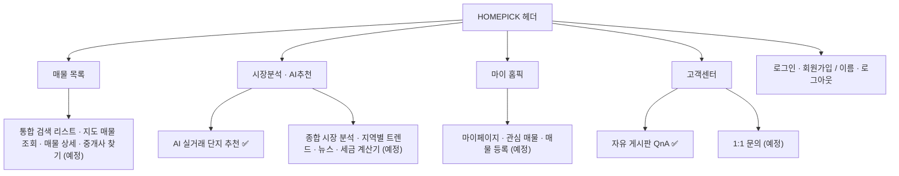
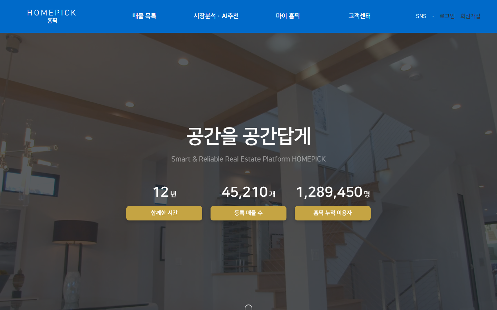
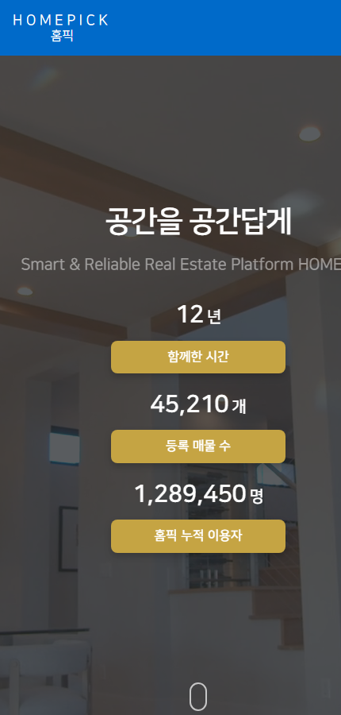
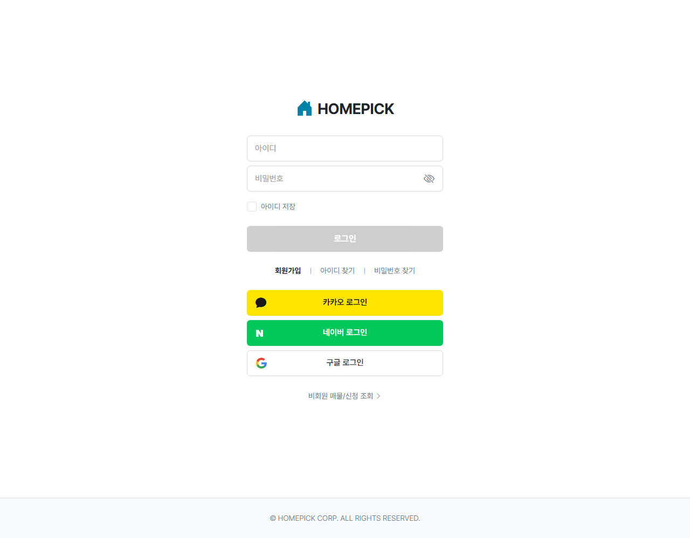
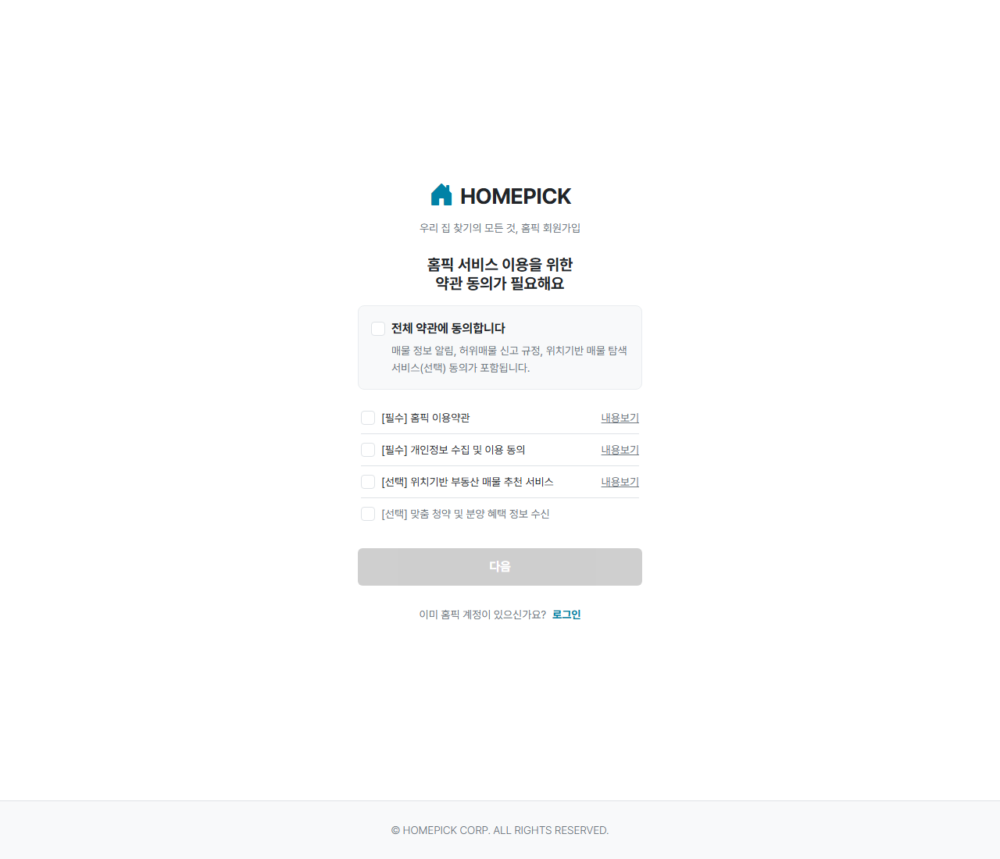
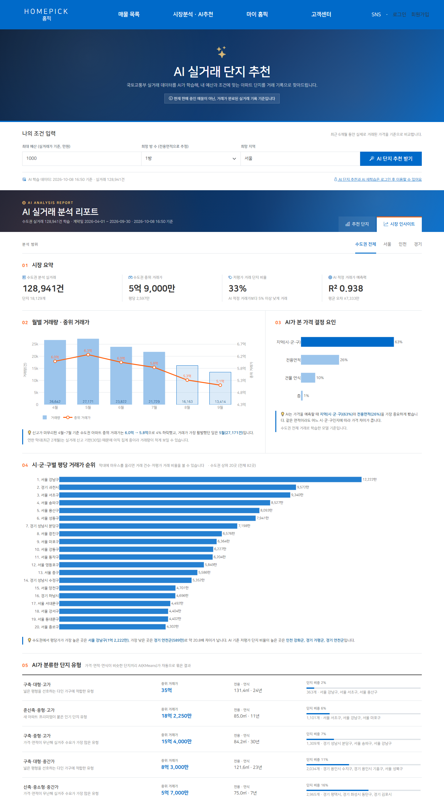
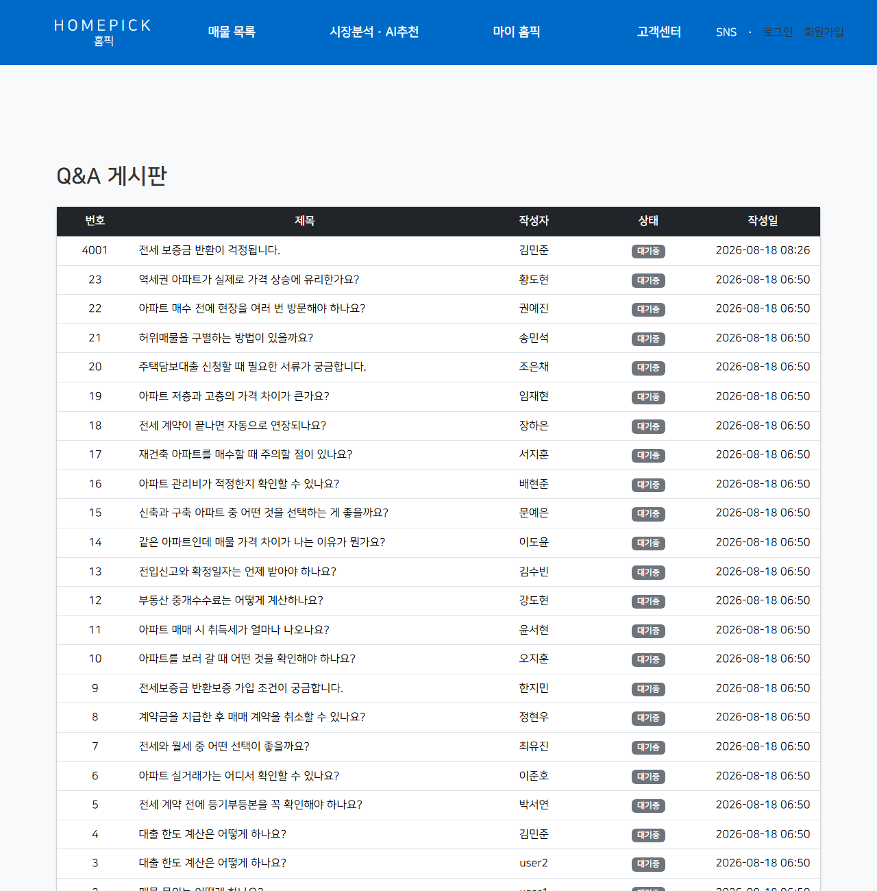

# 6. 화면 설계서

[← 5. 시스템 아키텍처 설계서](05-architecture.md) · [산출물 목차](README.md)

실제 운영 화면을 캡처해 화면별 구성 요소와 동작을 정리했습니다. (캡처: 2026-10-12, 비로그인 상태)

---

## 6-1. 화면 목록 · 메뉴 구조

| ID | 화면명 | URL | 템플릿 | 접근 |
|---|---|---|---|---|
| SCR-01 | 메인 | `/` | `index.html` | 누구나 |
| SCR-02 | 로그인 | `/member/login` | `member/login.html` | 누구나 |
| SCR-03 | 회원가입 (4단계) | `/member/register` | `member/register.html` | 누구나 |
| SCR-04 | AI 실거래 단지 추천 | `/ai/recommend` | `sub/ai-recommend.html` | 열람 누구나 · 추천/재학습 로그인 |
| SCR-05 | Q&A 게시판 | `/qna` | `qna/list.html` | 누구나 |
| COM | 공통 헤더 · 푸터 | - | `common/header.html` · `footer.html` | - |

---

## SCR-01 메인

| 번호 | 영역 | 설명 |
|---|---|---|
| ① | 헤더 | 로고(메인 이동), 메뉴 4개 (마우스를 올리면 하위 메뉴), 오른쪽 로그인 · 회원가입. 로그인 시 이름 · 로그아웃 |
| ② | 히어로 | 전체 화면 배경, "공간을 공간답게" 문구, 숫자 카운트 (함께한 시간 · 등록 매물 수 · 누적 이용자) |
| ③ | 인기 아파트 | Popular Apartment 탭별 순위 |
| ④ | 푸터 | 약관 링크 · 패밀리사이트 · 회사 정보 · 사이트맵, 오른쪽 아래 **맨 위로** 버튼 (300px 이상 스크롤 시 표시) |

**모바일 (430px)** — 헤더의 데스크톱 메뉴는 숨겨지고, 숫자 카운트가 세로로 배치됩니다.

---

## SCR-02 로그인

| 번호 | 요소 | 동작 |
|---|---|---|
| ① | 아이디 · 비밀번호 | 형식이 맞아야 로그인 버튼 활성화, 눈 아이콘으로 비밀번호 보기 |
| ② | 아이디 저장 | 체크 박스 (화면 구현) |
| ③ | 로그인 버튼 | `POST /member/login`, 실패 시 상단에 오류 메시지 · 입력한 아이디 유지 |
| ④ | 회원가입 · 아이디 찾기 · 비밀번호 찾기 | 회원가입 화면으로 이동 (찾기는 예정) |
| ⑤ | 카카오 · 네이버 · 구글 로그인 | 각 제공자 브랜드 색 버튼, OAuth2 로그인 · 처음이면 자동 가입 |

---

## SCR-03 회원가입 (4단계)

| 단계 | 화면 요소 | 검증 · 동작 |
|---|---|---|
| 1. 약관 동의 (위 화면) | 전체 동의 + 필수 2 · 선택 2, 내용보기 | 전체 동의 ↔ 개별 4개 연동, 필수 2개 체크 시 "다음" 활성 |
| 2. 기본 정보 | 이름, 생년월일 8자리, 성별 버튼 | 이름 2자 이상, 날짜 형식, 성별 선택 시 "다음" 활성 |
| 3. 휴대폰 인증 | 휴대폰 번호, 인증번호 받기, 인증 모달(6자리 · 3분 타이머 · 재발송) | Firebase reCAPTCHA · SMS, 성공 시 다음 단계 |
| 4. 계정 정보 | 아이디, 비밀번호, 비밀번호 확인 | 아이디 4~20자, 비밀번호 영문+숫자 8자 이상, 확인 일치 → 가입하기 |

---

## SCR-04 AI 실거래 단지 추천

| 번호 | 영역 | 설명 |
|---|---|---|
| ① | 히어로 | 페이지 제목, 설명, **"현재 판매 중인 매물이 아닌, 거래가 완료된 실거래 기록 기준입니다"** 안내 |
| ② | 나의 조건 입력 (검색 바) | 최대 예산(만원) · 희망 방 수 · 희망 지역 → **AI 단지 추천 받기**. 비로그인 시 로그인 안내 |
| ③ | 데이터 정보 줄 | AI 학습 데이터 기준 시각 · 실거래 건수. 로그인 시 **최신 데이터로 AI 재학습** 버튼, 비로그인 시 로그인 링크 |
| ④ | 재학습 진행 패널 | 단계(준비 → 크롤링 → 전처리 → 학습 → 서버 반영 → 완료), 경과 시간, 진행 막대, 실패 시 원인 (로그인 사용자에게만 표시) |
| ⑤ | AI 실거래 분석 리포트 헤더 | 학습 건수 · 계약일 범위 · 기준 시각, 탭: **추천 단지 / 시장 인사이트** |
| ⑥ | 분석 범위 탭 | 수도권 전체 · 서울 · 인천 · 경기 |
| ⑦ | 01 시장 요약 | 분석 실거래 건수 · 중위 거래가 · 저평가 거래 비율 · AI 예측력(R²) |
| ⑧ | 02 월별 거래량 · 중위 거래가 | 막대(거래량) + 선(중위가), 최근 2개월은 연한 막대 (Plotly) |
| ⑨ | 03 AI가 본 가격 결정 요인 | RandomForest 중요도 가로 막대 (지역 · 면적 · 연식 · 층) |
| ⑩ | 04 시·군·구별 평당 거래가 순위 | 상위 20곳, 검색 지역은 주황색 강조, 마우스 오버 시 상세 |
| ⑪ | 05 AI가 분류한 단지 유형 | KMeans 유형 이름 · 중위가 · 면적 · 연식 · 비중 |
| ⑫ | 추천 단지 탭 (추천 후) | 순위 행: 단지명 · 지역 · 실거래 중위가 · 면적 · 추정 방 수 · 최근 거래일 · 점수 막대 · AI 근거 문장 |

**상태별 화면**

| 상태 | 표시 |
|---|---|
| 비로그인 + 추천 클릭 | "로그인 후 이용할 수 있습니다 · 로그인하기" |
| 지역 데이터 없음 | "수도권(서울·인천·경기)만 지원합니다" + 예시 지역 |
| 조건에 맞는 단지 없음 | 지역 최저 실거래가 안내, 예산 · 방 수 조정 권유 |
| 재학습 중 | 진행 패널 + 버튼 비활성 |
| 재학습 실패 | 실패 단계와 원인 (예: 공공데이터 API 응답 시간 초과) |

---

## SCR-05 Q&A 게시판

| 열 | 내용 |
|---|---|
| 번호 | 게시글 ID (최신순) |
| 제목 · 작성자 | `qna` 테이블 값 |
| 상태 | 배지 (대기중) |
| 작성일 | `yyyy-MM-dd HH:mm` |

---

## 6-2. 디자인 가이드

| 항목 | 값 |
|---|---|
| 메인 컬러 | `#006AC9` 홈픽 블루 (헤더 · 버튼 · 강조) |
| 포인트 컬러 | `#FF600D` 오렌지 (검색 지역 강조 · 파비콘 체크) |
| 텍스트 | `#333333` 본문 · `#888888` 보조 |
| 글꼴 | NanumSquare, Noto Sans KR |
| 아이콘 | Font Awesome 6 |
| 그리드 · 반응형 | Bootstrap 5.3 (모바일 < 576px, 태블릿 < 992px, 데스크톱) |
| 파비콘 | 블루 배경 + 흰 집 + 오렌지 체크 (`favicon.svg` · `.ico` · `apple-touch-icon.png`) |
