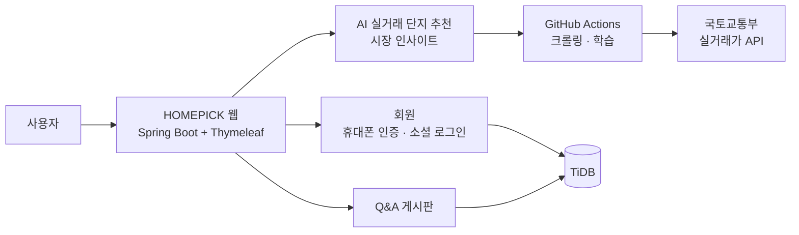

# HOMEPICK 프로젝트 산출물

> 국토교통부 아파트 실거래 데이터를 AI가 학습해, 내 예산과 조건에 맞는 단지를 **거래 기록**으로 찾아 주는 부동산 플랫폼

| 운영 주소 | |
|---|---|
| Render | <https://homepick.onrender.com> |
| AWS EC2 | <https://homepickkr.duckdns.org> |

## 문서 목록

아래 제목을 클릭하면 각 문서로 이동합니다. 다이어그램은 GitHub 에서 자동으로 그림으로 표시됩니다.

| No | 문서 | 내용 |
|:-:|---|---|
| 1 | [**플로 차트**](01-flowchart.md) | 전체 서비스 흐름, 회원가입 · 소셜 로그인 · AI 추천 · AI 재학습 흐름도 |
| 2 | [**프로젝트 기획서**](02-project-plan.md) | 개요, 추진 배경, 목표, 주요 기능, 기술 스택, 개발 일정, 기대 효과 |
| 3 | [**요구사항 정의서**](03-requirements.md) | 기능 요구사항 (회원 · AI · 데이터 · 게시판 · 공통), 비기능 요구사항 |
| 4 | [**프로세스 정의서**](04-process.md) | 프로세스 목록, 입력 · 처리 · 출력, 시퀀스 다이어그램 |
| 5 | [**시스템 아키텍처 설계서**](05-architecture.md) | 전체 구성도, 계층 구조, AI 파이프라인, DB(ERD), API 명세, 배포 구성 |
| 6 | [**화면 설계서**](06-screen-design.md) | 화면 목록 · 메뉴 구조, 실제 화면 캡처와 구성 요소 설명, 디자인 가이드 |

## 한눈에 보기

| 항목 | 내용 |
|---|---|
| 데이터 | 수도권 83개 시·군·구, 최근 6개월 실거래 약 12.9만 건 · 1.8만 단지 |
| AI 모델 | RandomForest (적정 거래가 · 저평가), KMeans (단지 유형) |
| 기술 | Java 21 · Spring Boot 4 · Thymeleaf · Bootstrap 5 · TiDB · Firebase · OAuth2 · Python · scikit-learn · Plotly |
| 배포 | GitHub Actions CI/CD → Render · AWS EC2 (Docker, nginx, SSL) |

## 작업 기록

기능별 상세 작업 내용과 문제 해결 과정은 [`docs/`](../) 폴더의 개별 문서에 정리되어 있습니다.
